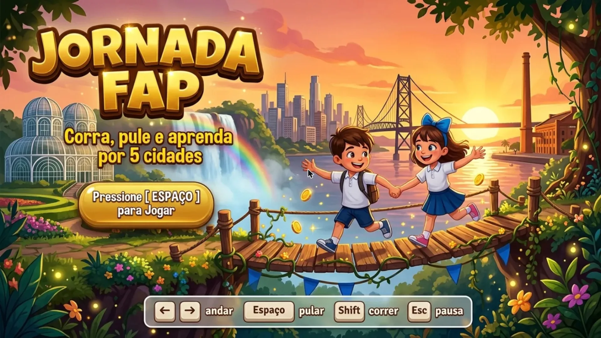
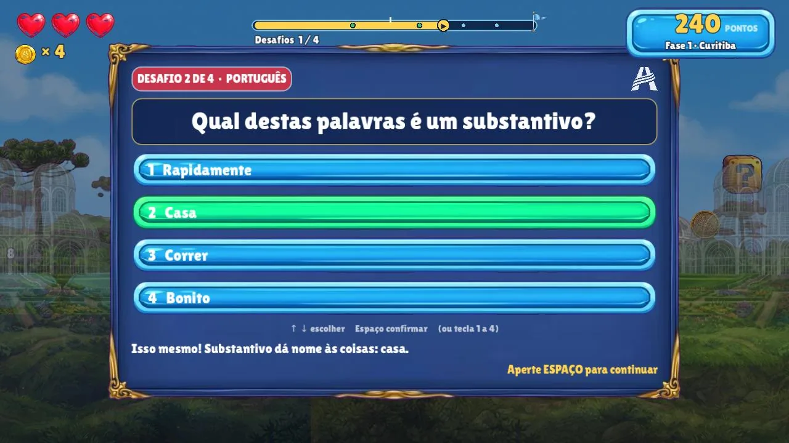
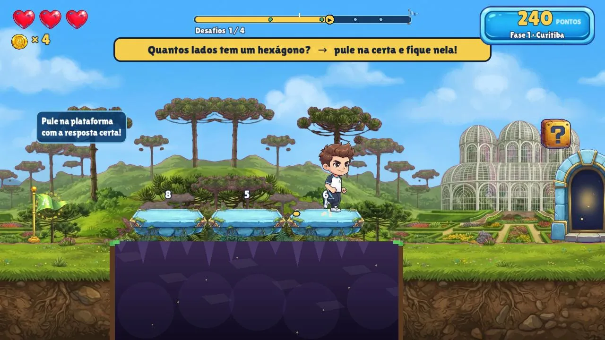
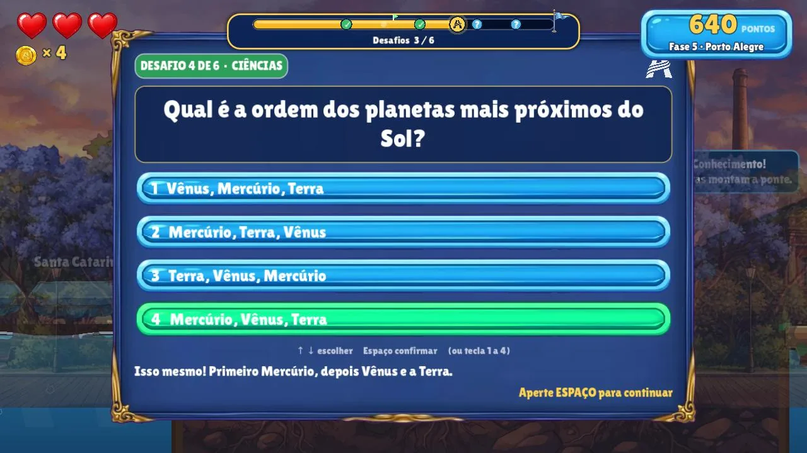
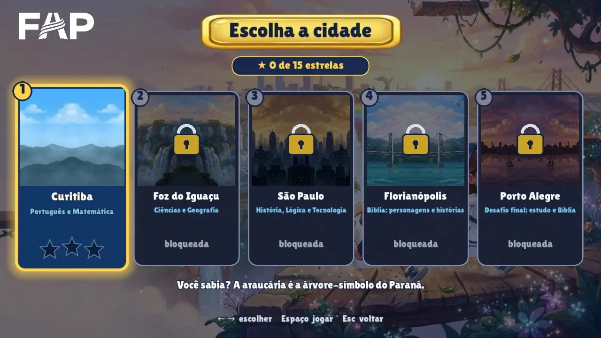
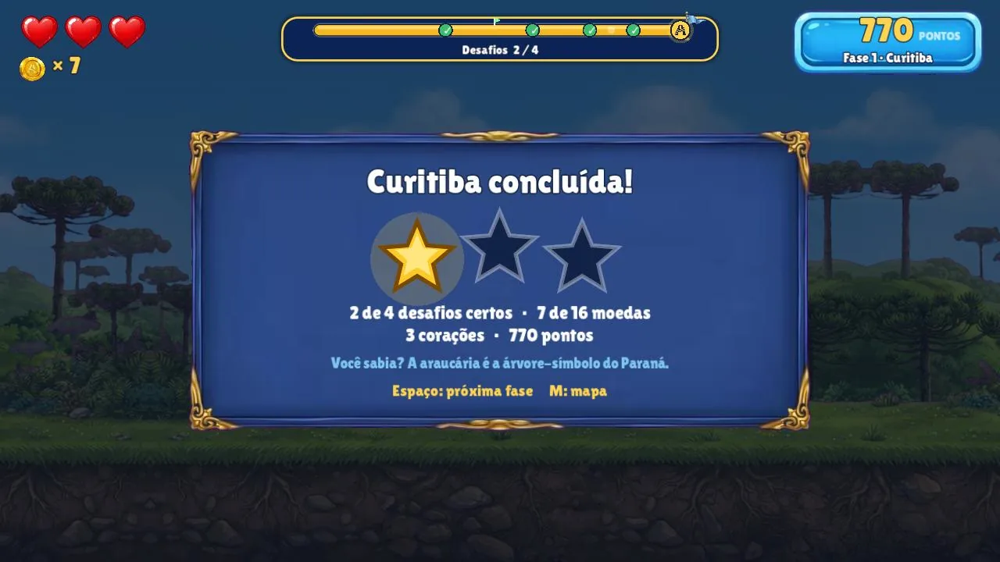

<h1 align="center">
   Jornada FAP
</h1>

<p align="center">
  
  
  
  
  
</p>

<p align="center">
  <strong>Corra, pule e aprenda por 5 cidades.</strong><br/>
  Um jogo de plataforma gratuito da Faculdade Adventista do Paraná, com desafios de estudo e Bíblia e um cupom de desconto no final.
</p>

<h3 align="center"><a href="https://github.com/dutrathiagodev/jornada-fap/releases"><ins>Baixar o jogo</ins></a></h3>

<p align="center">
  
</p>

## Recursos

<table>
<tr>
<td width="46%" valign="middle">

### Cada porta faz uma pergunta

Matemática, português, ciências, geografia, história, lógica, tecnologia e Bíblia. Responda com as setas e **Enter** (ou as teclas 1 a 4). Errou? O jogo explica a resposta e você continua.

</td>
<td width="54%">
  
</td>
</tr>
<tr>
<td width="46%" valign="middle">

### Pule na resposta certa

Três pedras flutuantes mostram três respostas. Pule na correta e fique nela até a barra dourada encher. Se errar, a pedra racha e você perde um coração.

</td>
<td width="54%">
  
</td>
</tr>
<tr>
<td width="46%" valign="middle">

### Cinco cidades, cinco aventuras

Curitiba, Foz do Iguaçu, São Paulo, Florianópolis e Porto Alegre, cada uma com cenário, matéria e obstáculo próprios. No fim, a Ponte do Conhecimento sobre o Guaíba.

</td>
<td width="54%">
  
</td>
</tr>
</table>

- **Mapa e estrelas:** ganhe até 3 estrelas por cidade; a próxima cidade abre quando você termina a anterior.
- **Um cupom só seu:** terminou as cinco cidades? Digite seu nome e o jogo gera o código de desconto para apresentar na FAP.
- **Controle de Xbox, PlayStation e similares:** analógico ou direcional andam, A (Cruz) pula e confirma. As dicas na tela trocam sozinhas para os botões do controle.
- **Música e efeitos sonoros:** a tecla `N` liga e desliga a música. O progresso fica salvo.
- **Sem anúncios, sem compras:** feito só com ferramentas livres.

<p align="center">
  
  
</p>

## Baixar o jogo pronto

Na página de [Releases](https://github.com/dutrathiagodev/jornada-fap/releases), baixe o arquivo do seu sistema:

| Sistema | Arquivo | Como instalar |
|---------|---------|---------------|
| Windows 10/11 (64 bits) | `JornadaFAP-windows-x64-setup.exe` | Dois cliques e siga o instalador (não precisa de administrador). Cria o atalho na área de trabalho |
| macOS (Apple Silicon e Intel) | `JornadaFAP-macos.pkg` | Dois cliques e siga o instalador. Instala em *Aplicativos* e cria o atalho na área de trabalho |
| Linux 64 bits | `JornadaFAP-linux-x64.tar.gz` | Extraia, abra o terminal na pasta e rode `./instalar.sh`. Cria o atalho na área de trabalho e no menu |

### O Windows mostrou uma tela azul ("O Windows protegeu o computador")?

Calma, é normal. É o **Microsoft Defender SmartScreen**, que aparece para qualquer programa novo ainda sem
assinatura digital paga. Os arquivos são gerados automaticamente pelo GitHub Actions a partir deste repositório.
Dois cliques resolvem (só na primeira vez):

1. Clique em **Mais informações**.
2. Clique em **Executar assim mesmo**.

### No Mac o sistema bloqueou o instalador?

Clique com o botão direito no `JornadaFAP-macos.pkg` e escolha **Abrir**. Só na primeira vez.

### Linux

Depois de rodar `./instalar.sh`, o jogo fica em `~/.local/share/JornadaFAP`. Para remover:
`rm -rf ~/.local/share/JornadaFAP ~/.local/share/applications/jornada-fap.desktop`.

## Controles

| Ação | Teclado | Controle (Xbox / PlayStation) |
|------|---------|-------------------------------|
| Andar | ← → ou A D | Analógico esquerdo ou direcional |
| Pular (segure para pular mais alto) | Espaço, W ou ↑ | A / Cruz |
| Correr | Shift | X ou RB / Quadrado ou R1 (ou gatilho direito) |
| Escolher resposta | ↑ ↓ ← → ou teclas 1 a 4 | Direcional ou analógico |
| Confirmar e continuar | **Enter** | A / Cruz |
| Pausar | Esc ou P | Start |
| Voltar | Esc | B / Bolinha |
| Mapa (na pausa e no resultado) | M | Y / Triângulo |
| Reiniciar a fase (na pausa) | R | X / Quadrado |
| Música liga/desliga | N | |

## Como rodar pelo código

Requer o [Godot 4.7](https://godotengine.org/download) (versão padrão, sem .NET).

```bash
git clone https://github.com/dutrathiagodev/jornada-fap.git
cd jornada-fap
./jogar.sh          # Linux/macOS: abre o jogo pelo Godot que estiver em ferramentas/godot
```

Ou abra a pasta `jogo/` no editor do Godot e aperte **F5**.

<details>
<summary>Gerar os instaladores</summary>

O workflow `.github/workflows/release.yml` exporta o jogo com o Godot e monta o `.exe` (Inno Setup), o `.pkg` e o `.tar.gz`.
Crie uma tag (`git tag v1.0.0 && git push --tags`) para publicar na aba *Releases*, ou rode em
*Actions > Release > Run workflow* só para testar a build.

</details>

## Estrutura do repositório

| Pasta | O que tem |
|-------|-----------|
| `jogo/` | O jogo (projeto Godot): cenas, scripts, arte, música e banco de perguntas |
| `site/` | Landing page do jogo (Next.js, TypeScript e CSS Modules). Veja o [README do site](site/README.md) |
| `docs/` | Documentação do projeto: mecânicas, arquitetura, roteiro, desconto |
| `arte/` e `ferramentas/` | Material de arte e scripts que geram sons, músicas e sprites |

## Segurança

O código é aberto aos colaboradores do repositório e os instaladores são gerados pelo GitHub Actions.
Cada release traz o `SHA256SUMS.txt` para você conferir o seu download.

## Contribuir

Pull requests são bem-vindos. Novas perguntas ficam em `jogo/dados/perguntas/` (um arquivo JSON por cidade).
A lista das decisões ainda abertas com a FAP está em `docs/`.

## Aviso

Projeto acadêmico, com arte gerada por IA. Os logos da FAP e o símbolo da rede adventista são marcas de seus
respectivos titulares e seu uso depende da autorização da instituição. O percentual do cupom de desconto é uma
proposta e será confirmado pela secretaria da FAP.
