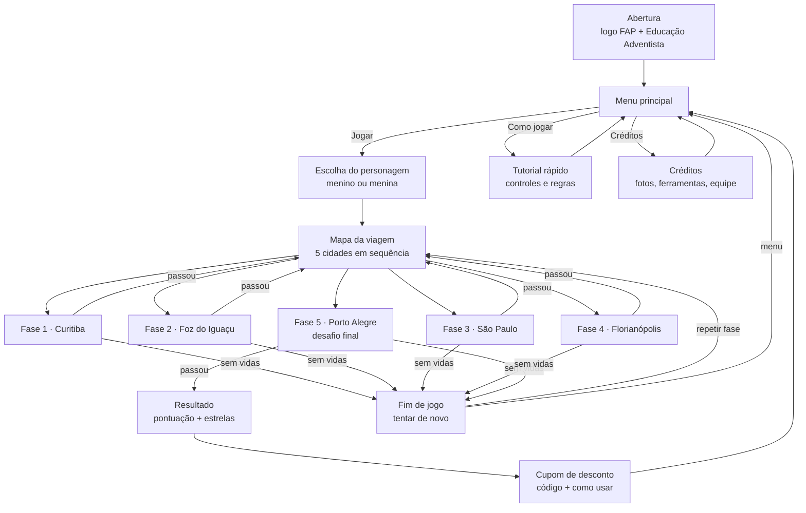
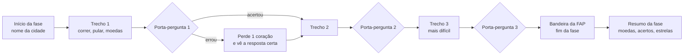
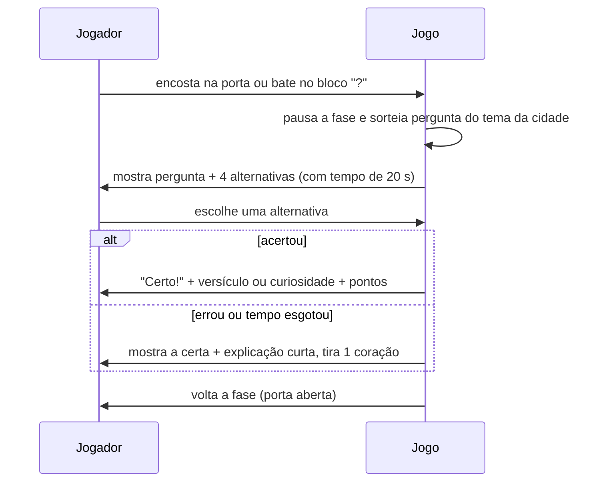

# 2. Fluxo do jogo

## 2.1 Fluxo de telas

**Regras do fluxo**
- As fases são liberadas **em ordem**. Só dá para entrar na próxima depois de passar a anterior.
- O progresso fica salvo no aparelho (quais fases já passou e a melhor pontuação de cada uma).
- O botão **Pausar** existe dentro das fases: continuar, reiniciar a fase ou voltar ao mapa.
- O cupom só aparece depois de passar a **Fase 5**. Se o jogador parar antes, vê quanto faltou.

## 2.2 Fluxo dentro de uma fase

- Cada fase tem **3 portas-pergunta** no caminho. A porta só abre depois da resposta.
- Errar **não trava** o jogador: ele perde um coração, vê a explicação e segue em frente. A ideia é aprender, não punir.
- Ao longo do caminho também há **blocos "?"** opcionais. Bater por baixo abre uma pergunta bônus, que vale moedas extras.
- **Checkpoints:** cada porta-pergunta funciona como ponto de retorno se o jogador cair num buraco.

## 2.3 Fluxo de uma pergunta

## 2.4 Estados que o jogo guarda
| Dado | Onde | Para quê |
|------|------|----------|
| Personagem escolhido | memória da partida | trocar sprites |
| Fases liberadas e estrelas | arquivo local (`user://progresso.save`) | mapa e continuar depois |
| Pontuação, moedas, acertos | memória da partida | resultado e cupom |
| Perguntas já usadas | memória da partida | não repetir na mesma partida |
| Cupom gerado | arquivo local | mostrar de novo se fechar o jogo |
