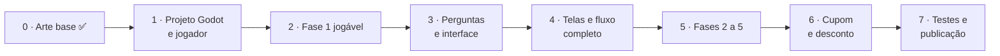

# 9. Roteiro de trabalho

## Etapas

### Etapa 0 — Arte base ✅ (concluída em 26/11/2026)
- [x] Godot baixado
- [x] Personagens (menino e menina) com 5 animações
- [x] 5 cenários em parallax (3 camadas cada)
- [x] Documentação

### Etapa 1 — Projeto Godot e jogador
- [ ] Criar o projeto em `jogo/` (Compatibility, 1920×1080)
- [ ] Copiar a arte para `jogo/assets/`
- [ ] `Jogador.tscn` com SpriteFrames (menino e menina) e movimento completo
- [ ] Input Map
- **Pronto quando:** o personagem anda, corre e pula num chão de teste com as animações certas.

### Etapa 2 — Fase 1 jogável (Curitiba)
- [ ] `FaseBase.tscn` com as 3 camadas `Parallax2D`
- [ ] Chão e plataformas com colisão
- [ ] Moedas, bloco "?", checkpoint e bandeira
- [ ] Inimigo Preguiça
- [ ] HUD (corações e moedas)
- **Pronto quando:** dá para jogar Curitiba do início ao fim.

> **Protótipo jogável (27/11/2026):** a Curitiba já roda em `jogo/` (`./jogar.sh`): menino com animações quadro a quadro, parallax, moedas, 3 portas-pergunta, caminho certo, checkpoint, bandeira, estrelas, sons e efeitos. Perguntas em `jogo/dados/perguntas/curitiba.json` (12, rascunho para revisão da FAP). Faltam as outras 4 fases, a menina, inimigos, telas de menu/mapa e cupom.

### Etapa 3 — Perguntas e interface
- [ ] Autoload `Perguntas` lendo JSON
- [ ] `JanelaPergunta` (4 alternativas, tempo, explicação)
- [ ] `PortaPergunta` ligada à janela
- [ ] `CaminhoCerto`: pergunta no alto, 3 a 4 plataformas com as alternativas, errada cai, 1 coração só na 1ª vez (ver [Desafios](10-desafios.md))
- [ ] 12 perguntas de Curitiba
- **Pronto quando:** as 3 portas e o caminho certo de Curitiba funcionam, com acerto, erro e explicação.

### Etapa 4 — Telas e fluxo completo
- [ ] Abertura, Menu, Escolha de personagem, Mapa, Pausa, Fim de jogo, Resultado, Créditos
- [ ] Autoloads `Jogo` e `Progresso` (salvar e carregar)
- **Pronto quando:** dá para seguir o fluxo de [02-fluxo-do-jogo.md](02-fluxo-do-jogo.md) inteiro com 1 fase.

### Etapa 5 — Fases 2 a 5
- [ ] Arte que falta (plataformas, inimigos, itens por cidade)
- [ ] Montar Foz, São Paulo, Florianópolis e Porto Alegre
- [ ] 48 perguntas restantes
- [ ] Ponte do Conhecimento (final de Porto Alegre)

### Etapa 6 — Cupom e desconto
- [ ] Decisões da FAP (ver lista abaixo)
- [ ] Tela de cadastro com aceite de privacidade
- [ ] Geração do código (opção A ou B)

### Etapa 7 — Testes e publicação
- [ ] Testar com 5 a 10 estudantes (anotar onde travam)
- [ ] Ajustar dificuldade e tempos
- [ ] Botões de toque e teste no celular
- [ ] Exportar para Web e publicar (itch.io ou GitHub Pages)
- [ ] Exportar APK Android

## Decisões pendentes
| # | Decisão | Quem decide | Afeta |
|---|---------|-------------|-------|
| 1 | Percentual e regras do desconto | FAP (financeiro/marketing) | Etapa 6 |
| 2 | Cupom sem servidor (A) ou com servidor (B) | FAP + equipe | Etapa 6 |
| 3 | Autorização para usar logo e uniforme | FAP / Educação Adventista | Publicação |
| 4 | Quem revisa as perguntas (professor e pastor) | FAP | Etapas 3 e 5 |
| 5 | Onde publicar (site da FAP, itch.io, loja) | FAP + equipe | Etapa 7 |
| 6 | Prazo de entrega do trabalho | Faculdade | Todas |

## Riscos
| Risco | Como evitar |
|-------|-------------|
| Arte nova do Gemini não combina com a atual | Usar sempre os mesmos termos de estilo e conferir lado a lado |
| Jogo Web pesado (imagens grandes) | Comprimir em WebP e reduzir as camadas de fundo para 0,75× |
| Perguntas com erro | Revisão obrigatória antes de publicar |
| Cupom fraudado | Opção B (servidor) para uso real |

## Estado em 27/11/2026
- ✅ As 5 cidades jogáveis do começo ao fim, com porta-pergunta, bloco bônus, caminho certo, checkpoints e bandeira final (Porto Alegre termina na Ponte do Conhecimento).
- ✅ Título, mapa, resultado (estrelas animadas), pausa e cupom em formato de ingresso, todos com a fonte e o estilo do jogo.
- ✅ Arte nova: moeda 3D girando, plataforma de pedra, buraco de caverna, coração e slime refeitos, bandeiras que ondulam (ver `07-arte-e-assets.md`).
- ✅ Perguntas respondem com as setas + Espaço (ou 1 a 4); Espaço continua em qualquer tela.
- ⏳ Falta: Veo (comemorar, dano, derrota, menina inteira; cota diária), sons/música, botões de toque, exportar Web/APK e as decisões pendentes abaixo (desconto, cupom, logo, revisores, prazo, versão da Bíblia).
