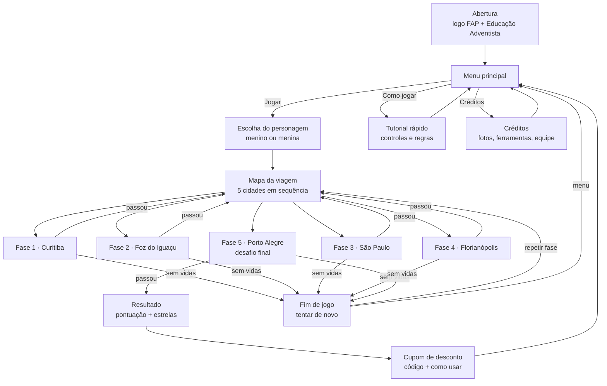
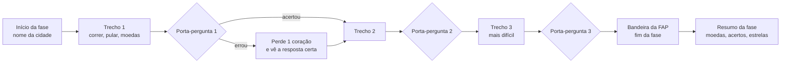
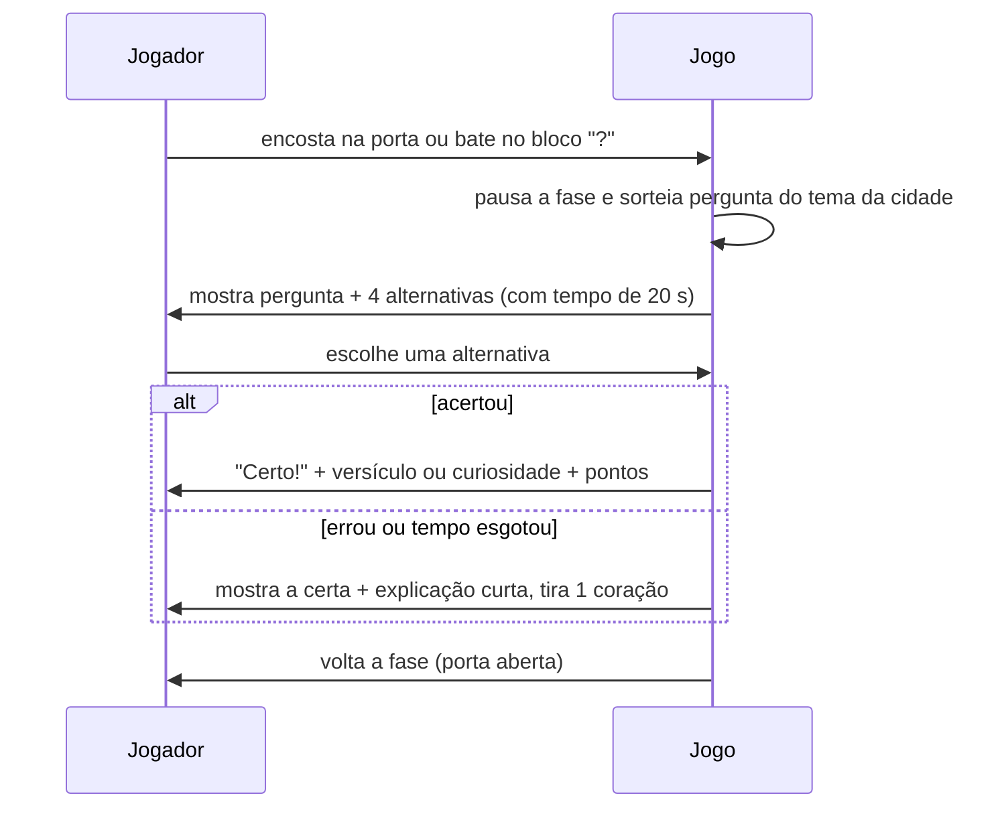
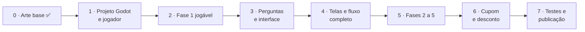

# JOGO-FAP — Documentação

Jogo de plataforma 2D (estilo Mario) da **Faculdade Adventista do Paraná (FAP)**.
O jogador atravessa 5 cidades do Sul/Sudeste, responde perguntas de estudo e da Bíblia e, ao final, ganha um **cupom de desconto**.

> Status (26/11/2026): arte pronta (personagens animados + 5 cenários em parallax). Montagem no Godot ainda **não começou**.

## Índice

| # | Documento | O que tem |
|---|-----------|-----------|
| 1 | [Visão geral](01-visao-geral.md) | Conceito, público, objetivo, escopo, plataformas |
| 2 | [Fluxo do jogo](02-fluxo-do-jogo.md) | Fluxo de telas e fluxo dentro de cada fase (diagramas) |
| 3 | [Mecânicas](03-mecanicas.md) | Controles, movimento, vidas, moedas, inimigos, pontuação |
| 4 | [Fases](04-fases.md) | As 5 cidades: tema, perguntas, obstáculos, dificuldade |
| 5 | [Perguntas](05-perguntas.md) | Banco de perguntas (estudo + Bíblia), formato do arquivo, exemplos |
| 6 | [Desconto](06-desconto.md) | Regras do cupom, segurança, LGPD, o que precisa da FAP |
| 7 | [Arte e assets](07-arte-e-assets.md) | Identidade visual, personagens, cenários, pastas, como regerar |
| 8 | [Arquitetura no Godot](08-arquitetura-godot.md) | Estrutura do projeto, cenas, scripts, configurações |
| 9 | [Roteiro de trabalho](09-roteiro.md) | Etapas, checklist e decisões pendentes |

Material antigo (primeiros rascunhos): pasta [`arquivo/`](arquivo/).

## Estrutura de pastas do projeto

```
JOGO-FAP/
├── docs/                  ← esta documentação
├── assets/
│   ├── personagens/       ← folhas de animação prontas (menino_sheet.png, menina_sheet.png)
│   ├── cenarios/<cidade>/parallax/   ← 3 camadas por cidade (1_fundo, 2_meio, 3_frente)
│   ├── gemini/            ← imagens originais geradas no Gemini (fonte)
│   └── referencias/       ← fotos reais de referência (Wikimedia, com créditos)
├── arte/                  ← peças recortadas dos personagens e rascunhos antigos (SVG/HTML)
├── ferramentas/
│   ├── godot/             ← Godot 4.7.2 (executável)
│   └── *.py               ← scripts que geram/animam a arte
└── jogo/                  ← (a criar) projeto Godot
```

## Ferramentas (todas gratuitas)
- **Godot 4.7.2** — motor do jogo (`ferramentas/godot/`).
- **Gemini** (conta Google) — geração da arte.
- **Python + Pillow** — recorte, animação e parallax (`ferramentas/*.py`).
- **Krita / LibreSprite / Piskel** — retoques manuais, se precisar.


---

# 1. Visão geral

## Conceito
Jogo de plataforma 2D com rolagem lateral, no estilo Super Mario. Dois estudantes da rede adventista (um menino e uma menina, de uniforme) viajam por **5 cidades**. Em cada cidade correm, pulam, coletam moedas e respondem **perguntas** para avançar. Quem termina ganha um **cupom de desconto** na FAP.

**Frase de apresentação:** *"Atravesse o Sul do Brasil, mostre o que você sabe e ganhe desconto para estudar na FAP."*

## Objetivos
| Para quem | Objetivo |
|-----------|----------|
| FAP | Divulgar a faculdade de forma divertida e captar interessados (vestibular/matrícula) |
| Jogador | Diversão rápida (10 a 15 min), testar conhecimentos e ganhar desconto |
| Trabalho da faculdade | Projeto completo: design, arte, programação e documentação |

## Público
- Principal: estudantes do ensino médio (15 a 18 anos), principalmente da rede adventista.
- Secundário: pais e comunidade da igreja.
- O jogo precisa ser **fácil de entender** e funcionar no **celular e no computador**.

## Valores do jogo
- Estudo e fé juntos: perguntas de conhecimento geral e da Bíblia.
- Linguagem positiva e respeitosa. Sem violência: os "inimigos" são ideias como *Preguiça*, *Distração* e *Dúvida*, e o jogador os vence pulando em cima.
- Identidade da Educação Adventista: azul-marinho, azul-claro, branco e o "A" da marca.

## Escopo da 1ª versão (MVP)
Entra:
- 2 personagens jogáveis (escolha no início).
- 5 fases (Curitiba, Foz do Iguaçu, São Paulo, Florianópolis, Porto Alegre).
- Movimento: andar, correr, pular. Moedas, blocos de pergunta e inimigos simples.
- Perguntas de múltipla escolha (estudo e Bíblia).
- Tela final com pontuação e código de desconto.
- Versão Web (link) e Android.

Fica para depois:
- Ranking online, contas de usuário, som/música originais, mais cidades, modo para 2 jogadores.

## Plataformas
| Plataforma | Prioridade | Observação |
|------------|-----------|------------|
| Web (HTML5) | Alta | Basta um link para divulgar. Renderizador *Compatibility* do Godot. |
| Android | Alta | Controles na tela (botões de toque). |
| Windows/Linux | Média | Para apresentações e eventos. |

## Referências de estilo
- Visual: cartoon pintado à mão, no estilo Rayman Legends (parallax com várias camadas).
- Jogabilidade: Super Mario World (pular, moedas, blocos "?").


---

# 2. Fluxo do jogo

## 2.1 Fluxo de telas



**Regras do fluxo**
- As fases são liberadas **em ordem**. Só dá para entrar na próxima depois de passar a anterior.
- O progresso fica salvo no aparelho (quais fases já passou e a melhor pontuação de cada uma).
- O botão **Pausar** existe dentro das fases: continuar, reiniciar a fase ou voltar ao mapa.
- O cupom só aparece depois de passar a **Fase 5**. Se o jogador parar antes, vê quanto faltou.

## 2.2 Fluxo dentro de uma fase



- Cada fase tem **3 portas-pergunta** no caminho. A porta só abre depois da resposta.
- Errar **não trava** o jogador: ele perde um coração, vê a explicação e segue em frente. A ideia é aprender, não punir.
- Ao longo do caminho também há **blocos "?"** opcionais. Bater por baixo abre uma pergunta bônus, que vale moedas extras.
- **Checkpoints:** cada porta-pergunta funciona como ponto de retorno se o jogador cair num buraco.

## 2.3 Fluxo de uma pergunta



## 2.4 Estados que o jogo guarda
| Dado | Onde | Para quê |
|------|------|----------|
| Personagem escolhido | memória da partida | trocar sprites |
| Fases liberadas e estrelas | arquivo local (`user://progresso.save`) | mapa e continuar depois |
| Pontuação, moedas, acertos | memória da partida | resultado e cupom |
| Perguntas já usadas | memória da partida | não repetir na mesma partida |
| Cupom gerado | arquivo local | mostrar de novo se fechar o jogo |


---

# 3. Mecânicas

## 3.1 Controles
| Ação | Teclado | Controle | Celular (botões na tela) |
|------|---------|----------|--------------------------|
| Andar | ← → ou A D | analógico / direcional | setas à esquerda |
| Correr | Shift (segurar) | X | correr automático ao segurar a seta |
| Pular | Espaço, W ou ↑ | A | botão "Pular" à direita |
| Responder pergunta | 1 a 4 ou clique | direcional + A | toque na alternativa |
| Pausar | Esc / P | Start | botão ‖ no canto |

Nomes das ações no Godot (Input Map): `mover_esquerda`, `mover_direita`, `correr`, `pular`, `pausar`.

## 3.2 Movimento do personagem
Valores iniciais. São ajustados nos testes e ficam em variáveis exportadas do script do jogador.

| Parâmetro | Valor inicial |
|-----------|---------------|
| Velocidade andando | 320 px/s |
| Velocidade correndo | 520 px/s |
| Aceleração / freio | 2200 / 2600 px/s² |
| Altura do pulo | ~260 px (pulo curto se soltar o botão cedo) |
| Gravidade | 2400 px/s² (caindo: ×1,4 para não "flutuar") |
| Coyote time | 0,1 s (ainda pula logo depois de sair da beirada) |
| Jump buffer | 0,12 s (aperto um pouco antes de tocar o chão vale) |

**Animações** (já prontas nas folhas de sprite):
| Estado | Animação | Quadros | FPS |
|--------|----------|---------|-----|
| Parado | `parado` | 8 | 8 |
| Andando/correndo | `correr` | 8 | 12 (andando) / 16 (correndo) |
| Subindo no pulo | `pular` | 2 | 8 |
| Caindo | `cair` | 2 | 8 |
| Fim de fase / acerto | `comemorar` | 6 | 10 |
| Levou dano | `dano` | 4 | 10 |
| Sem corações | `derrota` | 6 | 8 |

O sprite olha para a direita. Para a esquerda usa `flip_h = true`.

## 3.3 Vidas e dano
- **3 corações** por fase.
- Perde 1 coração quando: encosta num inimigo de lado, erra uma pergunta ou cai num buraco (nesse caso volta ao último checkpoint).
- Depois de levar dano, fica **1,5 s piscando**, sem levar dano de novo.
- Sem corações: tela **Fim de jogo**, com as opções repetir a fase ou voltar ao menu.

## 3.4 Itens e objetos
| Objeto | Como funciona | Pontos |
|--------|---------------|--------|
| Moeda "A" | encostar para pegar | +10 |
| Livro | item raro escondido, dá 1 coração extra (máx. 3) | +50 |
| Bloco "?" (azul-marinho) | bater por baixo, abre pergunta bônus | +100 se acertar |
| Porta-pergunta | obrigatória, abre com resposta | +200 se acertar |
| Bandeira FAP | fim da fase | +500 |
| Plataformas | fixas e móveis (horizontal/vertical) | — |

## 3.5 Inimigos (sem violência)
São "maus hábitos" do estudante, desenhados de forma fofa:

| Inimigo | Comportamento | Como vencer |
|---------|---------------|-------------|
| **Preguiça** (bichinho sonolento) | anda devagar de um lado para o outro | pular em cima |
| **Distração** (celular com asinhas) | voa em onda | pular em cima |
| **Dúvida** (nuvenzinha "?") | aparece e some; só some de vez quando o jogador acerta a pergunta seguinte | responder certo |

Pular em cima dá +50 pontos e um pulinho extra.

## 3.6 Pontuação e estrelas
Pontuação da fase = moedas + acertos + bônus de tempo + corações restantes × 100.

Estrelas por fase:
- ★ terminou a fase
- ★★ terminou acertando pelo menos 2 das 3 portas
- ★★★ acertou as 3 portas e pegou 80% das moedas

O total de estrelas (máx. 15) define a faixa de desconto. Ver [Desconto](06-desconto.md).

## 3.7 Câmera e parallax
- `Camera2D` segue o jogador com suavização e limites na largura da fase.
- O cenário usa **3 camadas `Parallax2D`**: fundo (0,12), meio (0,4) e frente/chão (1,0), repetindo na horizontal.
- O chão onde o jogador pisa é colisão própria (`StaticBody2D`/`TileMapLayer`), alinhada com o desenho da camada da frente.


---

# 4. Fases

Ordem fixa, com dificuldade crescente. Cada fase leva de 2 a 3 minutos e tem 3 portas-pergunta.

| # | Cidade | Tema das perguntas | Dificuldade | Novidade de jogabilidade |
|---|--------|--------------------|-------------|--------------------------|
| 1 | Curitiba | Português e Matemática básica | ★☆☆ | Tutorial: andar, pular, moeda, 1º bloco "?" |
| 2 | Foz do Iguaçu | Ciências e Geografia | ★★☆ | Plataformas móveis (troncos no rio), inimigo Distração |
| 3 | São Paulo | História, Lógica e Tecnologia | ★★☆ | Telhados e pulos longos, correr fica importante |
| 4 | Florianópolis | Bíblia: personagens e histórias | ★★★ | Areia (escorrega um pouco), inimigo Dúvida |
| 5 | Porto Alegre | Desafio final: estudo + Bíblia | ★★★ | Sequência de 3 perguntas seguidas antes da bandeira |

## Detalhes por fase

### Fase 1 — Curitiba
- **Cenário:** céu azul com a Serra do Mar, morros com araucárias, a Estufa do Jardim Botânico e um chão de grama.
- **Camadas:** `assets/cenarios/curitiba/parallax/`. Topo do chão em **y = 771** (de 1080).
- **Ensina:** movimento, pulo, pegar moeda e bater no bloco "?". Placas com dicas no começo.
- **Inimigo:** Preguiça (poucos).
- **Curiosidade ao acertar:** "A araucária é a árvore-símbolo do Paraná."

### Fase 2 — Foz do Iguaçu
- **Cenário:** Cataratas com arco-íris ao pôr do sol, mata atlântica com tucanos e quatis, e grama sobre terra vermelha.
- **Camadas:** `assets/cenarios/foz/parallax/`. Topo do chão em **y = 731**.
- **Novidade:** troncos flutuando que se movem e buracos com "água".
- **Inimigos:** Preguiça e Distração.

### Fase 3 — São Paulo
- **Cenário:** skyline dourado com Copan e Edifício Itália, o MASP, ipês, e chão de calçada de ondas pretas e brancas.
- **Camadas:** `assets/cenarios/sao_paulo/parallax/`. Topo do chão em **y = 810**.
- **Novidade:** pular entre toldos e telhados (plataformas em várias alturas).
- **Inimigos:** Distração (mais rápido).

### Fase 4 — Florianópolis
- **Cenário:** mar turquesa com a Ponte Hercílio Luz, casinhas açorianas e coqueiros, e chão de areia com conchas.
- **Camadas:** `assets/cenarios/florianopolis/parallax/`. Topo do chão em **y = 778**.
- **Novidade:** areia com menos atrito e dunas em rampa.
- **Inimigos:** Dúvida e Preguiça.

### Fase 5 — Porto Alegre (final)
- **Cenário:** pôr do sol no Guaíba com a Catedral, a Usina do Gasômetro e jacarandás, e chão de grama.
- **Camadas:** `assets/cenarios/porto_alegre/parallax/`. Topo do chão em **y = 777**.
- **Novidade:** no fim, a **"Ponte do Conhecimento"**: 3 perguntas seguidas, e cada acerto monta um pedaço da ponte até a bandeira.
- **Inimigos:** todos, em menor quantidade (o foco são as perguntas).

## Como uma fase é montada (padrão para todas)
1. Fundo: 3 camadas `Parallax2D` da cidade.
2. Chão e plataformas: `TileMapLayer` invisível de colisão, mais blocos visuais.
3. Itens: moedas, blocos "?", livro (cenas reutilizáveis).
4. Inimigos posicionados à mão.
5. 3 `PortaPergunta`, cada uma com o tema da cidade.
6. `BandeiraFim` no final.
7. Limites da câmera = largura da fase (cerca de 8 000 a 12 000 px).


---

# 5. Banco de perguntas

## 5.1 Regras
- Múltipla escolha com **4 alternativas** e **1 correta**.
- Texto curto: a pergunta com no máximo 120 caracteres e cada alternativa com no máximo 40, para caber no celular.
- Toda pergunta tem uma **explicação** curta (≤ 140 caracteres), mostrada depois da resposta.
- As perguntas da Bíblia trazem a **referência** (livro, capítulo e versículo).
- Tempo para responder: 20 s (pode desligar nas opções de acessibilidade).
- As alternativas aparecem **embaralhadas** a cada vez.
- Mínimo para o MVP: **12 perguntas por fase** (3 portas + bônus + reserva para não repetir), ou seja, **60 no total**.
- **Revisão:** um professor da FAP revisa as perguntas de estudo e um pastor ou capelão revisa as da Bíblia.

## 5.2 Temas por fase
| Fase | Categoria (`tema`) | Exemplos de assunto |
|------|--------------------|---------------------|
| Curitiba | `portugues`, `matematica` | ortografia, crase, frações, porcentagem |
| Foz do Iguaçu | `ciencias`, `geografia` | ciclo da água, biomas, estados e capitais |
| São Paulo | `historia`, `logica`, `tecnologia` | Brasil República, sequências, informática |
| Florianópolis | `biblia` | personagens, milagres, parábolas |
| Porto Alegre | todos + `biblia` | mistura, nível difícil |

## 5.3 Formato do arquivo
Um arquivo JSON por fase em `jogo/dados/perguntas/<cidade>.json`. Assim dá para editar sem mexer em código.

```json
{
  "fase": "curitiba",
  "perguntas": [
    {
      "id": "cwb-001",
      "tema": "matematica",
      "dificuldade": 1,
      "pergunta": "Quanto é 25% de 80?",
      "alternativas": ["20", "25", "16", "40"],
      "correta": 0,
      "explicacao": "25% é um quarto. 80 ÷ 4 = 20."
    },
    {
      "id": "cwb-002",
      "tema": "portugues",
      "dificuldade": 1,
      "pergunta": "Qual palavra está escrita corretamente?",
      "alternativas": ["Exceção", "Excessão", "Eceção", "Esceção"],
      "correta": 0,
      "explicacao": "Exceção vem do verbo excetuar."
    }
  ]
}
```

Bíblia, com o campo extra `referencia`:
```json
{
  "id": "fln-001",
  "tema": "biblia",
  "dificuldade": 2,
  "pergunta": "Quem construiu a arca a pedido de Deus?",
  "alternativas": ["Noé", "Moisés", "Abraão", "Davi"],
  "correta": 0,
  "explicacao": "Deus pediu a Noé que construísse a arca.",
  "referencia": "Gênesis 6:13-14"
}
```

## 5.4 Exemplos iniciais (rascunho para revisão)
| Fase | Pergunta | Resposta |
|------|----------|----------|
| Curitiba | Qual é o plural de "cidadão"? | Cidadãos |
| Curitiba | 3/4 de 100 é igual a... | 75 |
| Foz | As Cataratas do Iguaçu ficam na divisa do Brasil com qual país? | Argentina |
| Foz | Qual bioma tem a mata das Cataratas? | Mata Atlântica |
| São Paulo | Em que ano foi proclamada a República no Brasil? | 1889 |
| São Paulo | Qual vem a seguir: 2, 4, 8, 16, ...? | 32 |
| Florianópolis | Quem derrotou o gigante Golias? | Davi (1 Samuel 17) |
| Florianópolis | Quantos discípulos Jesus escolheu? | 12 (Marcos 3:14) |
| Porto Alegre | Qual é o primeiro livro da Bíblia? | Gênesis |
| Porto Alegre | Qual é a raiz quadrada de 144? | 12 |

> O banco completo, com as 60 perguntas, é uma das tarefas do [roteiro](09-roteiro.md). Precisa de revisão da FAP antes de publicar.


---

# 6. Desconto

> ⚠️ **Os valores abaixo são uma proposta.** O percentual, a validade e as condições precisam ser definidos e aprovados pela FAP (setor financeiro ou de marketing) antes de publicar o jogo.

## 6.1 Proposta de faixas
| Estrelas (de 15) | Desconto sugerido |
|------------------|-------------------|
| Terminou as 5 fases (5 a 9 ★) | 5% |
| 10 a 13 ★ | 10% |
| 14 a 15 ★ | 15% |

- O desconto vale **só para quem termina a Fase 5**.
- Uma pessoa recebe **um cupom**. Jogar de novo pode melhorar a faixa, mas não gera cupons extras.

## 6.2 Como o cupom funciona

### Opção A — Código sem servidor (MVP, mais simples)
1. No fim, o jogo pede **nome e e-mail** (com aceite de privacidade).
2. Gera um código no formato `FAP-26-XXXX-YY`:
   - `XXXX` = 4 letras/números aleatórios.
   - `YY` = faixa de desconto mais um dígito verificador calculado com uma chave.
3. O jogador mostra ou envia o código para a secretaria, que confere o dígito numa planilha ou ferramenta simples.
- **Limitação:** quem souber programar pode tentar gerar códigos. Serve para uma ação de divulgação controlada.

### Opção B — Com servidor (recomendada para uso real)
1. O jogo envia o resultado para um servidor (por exemplo, Supabase grátis ou Google Forms/Planilha).
2. O servidor confere, registra e devolve um código único.
3. A secretaria consulta a lista para validar, e cada código só vale uma vez.
- **Vantagem:** evita fraude e a FAP fica com a lista de interessados (leads).

## 6.3 Privacidade (LGPD)
- Coletar **só o necessário**: nome, e-mail e, opcionalmente, telefone e curso de interesse.
- Mostrar um aviso claro, por exemplo: "Seus dados serão usados pela FAP para entrar em contato sobre o desconto".
- Ter caixa de aceite (não pré-marcada) e link para a política de privacidade da FAP.
- Menores de 18 anos: pedir o e-mail de um responsável, ou deixar o cupom só para resgate presencial.

## 6.4 O que precisa da FAP
- [ ] Percentual de desconto de cada faixa.
- [ ] Em que vale: matrícula, mensalidade, qual curso.
- [ ] Validade do cupom.
- [ ] Opção A ou B (e quem valida o código).
- [ ] Texto de privacidade aprovado.
- [ ] Autorização para usar o logo e o uniforme da Educação Adventista.


---

# 7. Arte e assets

## 7.1 Identidade visual
| Uso | Cor | Hex |
|-----|-----|-----|
| Marca, mangas, calça, interface | Azul-marinho | `#0B3A6E` |
| Detalhes, debrum, destaques | Azul-claro | `#7CC6EA` |
| Camisa, textos sobre o azul | Branco | `#F8FAFC` |
| Contornos | Azul-noite | `#14213D` |
| Moedas e estrelas | Dourado | `#FFD34E` |

- **Logo:** o "A" da Educação Adventista (logo enviado no chat; salvar em `assets/referencias/identidade/`).
- **Fonte sugerida (grátis):** *Baloo 2* ou *Nunito* (Google Fonts), arredondadas e legíveis no celular.
- **Estilo:** cartoon pintado à mão (Rayman Legends), com contorno escuro nos personagens para destacá-los do cenário.

## 7.2 Personagens
- **Arquivos:** `assets/personagens/menino_sheet.png` e `menina_sheet.png`.
- **Folha de sprites:** 3072 × 2688 px, com **quadros de 384 × 384** (8 colunas × 7 linhas) e fundo transparente.
- **Personagem modular (v2):** peças do Gemini em `assets/gemini/v2/` (cabeça com 5 expressões, tronco, braço, antebraço, mão fechada e aberta, perna e tênis), recortadas em `arte/partes_v2/`. O esqueleto tem pescoço, ombros, cotovelos, pulsos, quadril, joelhos e tornozelos. Script: `ferramentas/animar_v2.py`.

| Linha | Animação | Quadros usados |
|-------|----------|----------------|
| 0 | parado | 8 |
| 1 | correr | 8 |
| 2 | pular | 2 |
| 3 | cair | 2 |
| 4 | comemorar | 6 |
| 5 | dano (tonto) | 4 |
| 6 | derrota | 6 |

- O pé fica em **y ≈ 371** dentro do quadro (a base da colisão no Godot).
- O personagem ocupa cerca de 340 px de altura no quadro. No jogo, a escala sugerida é **0,65** (cerca de 170 px de altura numa tela 1080p).
- **Como foram feitos:** o Gemini gerou o personagem em peças separadas (`assets/gemini/*_partes_gemini.jpeg`). O script `ferramentas/recortar_partes.py` recorta as peças e o `ferramentas/animar_partes.py` monta o esqueleto e anima.
- **Para mudar uma pose:** editar a função `anims()` em `animar_v2.py` e rodar de novo:
  ```
  python3 ferramentas/animar_v2.py menino assets/personagens/menino_sheet.png
  ```
- A versão anterior (v1) está guardada em `assets/personagens/v1-gemini/`.

## 7.3 Cenários (parallax)
Cada cidade tem 3 camadas PNG de **≈ 3870 × 1080**, que repetem na horizontal sem emenda (imagem + cópia espelhada).

| Cidade | Pasta | Topo do chão (y/1080) |
|--------|-------|-----------------------|
| Curitiba | `assets/cenarios/curitiba/parallax/` | 771 |
| Foz do Iguaçu | `assets/cenarios/foz/parallax/` | 731 |
| São Paulo | `assets/cenarios/sao_paulo/parallax/` | 810 |
| Florianópolis | `assets/cenarios/florianopolis/parallax/` | 778 |
| Porto Alegre | `assets/cenarios/porto_alegre/parallax/` | 777 |

| Camada | Arquivo | Velocidade sugerida no `Parallax2D` |
|--------|---------|-------------------------------------|
| Fundo (céu e paisagem distante) | `1_fundo.png` | `scroll_scale = 0.12` |
| Meio (prédios e árvores) | `2_meio.png` | `scroll_scale = 0.4` |
| Frente (chão) | `3_frente.png` | `scroll_scale = 1.0` |

**Como foram feitos:**
1. O Gemini gera cada camada separada. As camadas de meio e de frente vêm sobre fundo **magenta #FF00FF**.
2. Cada imagem é capturada **como aparece na tela** (1376 × 768).
3. O script `ferramentas/camadas_parallax.py` remove o magenta, deixa a camada repetível, aplica o ajuste de altura e salva o PNG:
   ```
   python3 ferramentas/camadas_parallax.py assets/gemini/camadas_<cidade> assets/cenarios/<cidade>/parallax
   ```
   O ajuste de altura da camada do meio fica em `assets/gemini/camadas_<cidade>/deslocamento.txt` (ex.: `2_meio=-0.15` sobe 15%).
4. A prévia com os personagens vem do `ferramentas/demo_parallax.py` (gera `demo_parallax.gif`).

> ⚠️ **Gemini:** **não use** o botão "baixar em tamanho original" nas imagens com fundo magenta. Ele refaz a imagem e inventa coisas (já misturou a ponte de Florianópolis no cenário de Curitiba). Capture a imagem exibida.

## 7.4 Arte que ainda falta
| Item | Prioridade | Sugestão |
|------|-----------|----------|
| Moeda "A", bloco "?", livro, bandeira FAP | Alta | Gemini (fundo magenta) + recorte |
| Inimigos (Preguiça, Distração, Dúvida) | Alta | Gemini em peças + animação simples (balanço) |
| Plataformas (grama, tronco, toldo, deck) | Alta | Gemini por cidade |
| Interface: botões, corações, caixa de pergunta | Alta | Godot (desenho com `StyleBox`) + ícones |
| Tela de título e mapa da viagem | Média | Gemini |
| Sons e música | Média | Freesound / OpenGameArt (CC0) |

## 7.5 Créditos e licenças
- Arte gerada no Gemini (Google), com uso conforme os termos do serviço.
- Fotos de referência: Wikimedia Commons, com autores e licenças em `assets/referencias/CREDITOS.md` (algumas CC BY/BY-SA pedem crédito na tela de créditos).
- Logo e uniforme da Educação Adventista: marca registrada, com uso **sujeito à autorização** da instituição.
- Godot: licença MIT, com o aviso na tela de créditos.


---

# 8. Arquitetura no Godot

## 8.1 Configuração do projeto
| Item | Valor |
|------|-------|
| Versão | Godot 4.7.2 (`ferramentas/godot/Godot_v4.7.2-stable_linux.x86_64`) |
| Pasta | `JOGO-FAP/jogo/` |
| Renderizador | **Compatibility** (funciona na Web e em celulares simples) |
| Resolução base | 1920 × 1080, `stretch_mode = canvas_items`, `aspect = expand` |
| Linguagem | GDScript |
| Física | 2D padrão do Godot |

## 8.2 Estrutura de pastas do jogo
```
jogo/
├── project.godot
├── autoload/
│   ├── Jogo.gd              ← estado da partida (personagem, pontos, vidas, fase atual)
│   ├── Progresso.gd         ← salvar/carregar progresso (user://progresso.save)
│   └── Perguntas.gd         ← carrega os JSON, sorteia sem repetir
├── cenas/
│   ├── telas/               ← Abertura, Menu, EscolhaPersonagem, Mapa, Resultado, Cupom, FimDeJogo, Creditos
│   ├── jogador/Jogador.tscn ← CharacterBody2D + AnimatedSprite2D + CollisionShape2D
│   ├── fases/               ← Fase_Curitiba.tscn ... Fase_PortoAlegre.tscn (herdam de FaseBase.tscn)
│   ├── objetos/             ← Moeda, BlocoPergunta, PortaPergunta, CaminhoCerto, Livro, BandeiraFim, PlataformaMovel, Checkpoint
│   ├── inimigos/            ← Preguica, Distracao, Duvida
│   └── ui/                  ← HUD (corações, moedas), JanelaPergunta, Pausa, BotoesToque
├── scripts/                 ← scripts compartilhados (se houver)
├── dados/perguntas/         ← curitiba.json, foz.json, sao_paulo.json, florianopolis.json, porto_alegre.json
└── assets/                  ← cópia/links da arte usada (personagens, cenários, ui, sons)
```

## 8.3 Cenas principais

**Jogador.tscn**
```
Jogador (CharacterBody2D)  ← Jogador.gd: movimento, pulo, dano, animação
├── Sprite (AnimatedSprite2D)  ← SpriteFrames feito da folha 384×384 (menino ou menina)
├── Colisao (CollisionShape2D)  ← cápsula ~70×150 (na escala 0,5)
├── Pes (RayCast2D)  ← opcional, para detectar a beirada
└── Camera2D  ← suavização ligada, limites definidos pela fase
```

**FaseBase.tscn**, da qual todas as fases herdam:
```
Fase (Node2D)  ← Fase.gd: tema das perguntas, início/fim, checkpoints
├── Fundo (Node2D)
│   ├── CamadaFundo (Parallax2D, scroll_scale 0.12, repeat_size.x = largura da imagem)
│   ├── CamadaMeio  (Parallax2D, scroll_scale 0.4)
│   └── CamadaFrente(Parallax2D, scroll_scale 1.0)
├── Chao (TileMapLayer ou StaticBody2D)  ← colisão alinhada ao topo do chão da cidade
├── Objetos (Node2D)  ← moedas, blocos, portas, plataformas
├── Inimigos (Node2D)
├── Jogador (instância)
├── BandeiraFim
└── UI (CanvasLayer) ← HUD + JanelaPergunta + Pausa + BotoesToque
```

## 8.4 Scripts globais (Autoload)
| Autoload | Responsabilidade | Funções principais |
|----------|------------------|--------------------|
| `Jogo` | estado da partida | `iniciar_partida(personagem)`, `adicionar_pontos(n)`, `perder_vida()`, `concluir_fase(estrelas)` |
| `Progresso` | gravação local | `salvar()`, `carregar()`, `fase_liberada(n)`, `estrelas_total()` |
| `Perguntas` | banco de perguntas | `carregar(fase)`, `sortear(tema) -> Dictionary`, `marcar_usada(id)` |

**Sinais (eventos) entre as cenas:**
- `PortaPergunta.pergunta_pedida(tema)` → a `JanelaPergunta` abre e o jogo pausa (`get_tree().paused = true`, com a janela em `process_mode = ALWAYS`).
- `JanelaPergunta.respondida(acertou: bool)` → a porta abre, `Jogo` soma pontos ou tira vida.
- `Jogador.morreu` → volta ao checkpoint ou abre a tela de Fim de Jogo.
- `BandeiraFim.alcancada` → resumo da fase, depois volta ao Mapa.

## 8.5 Input Map
| Ação | Teclas |
|------|--------|
| `mover_esquerda` | ←, A, direcional esquerda |
| `mover_direita` | →, D, direcional direita |
| `correr` | Shift, X do controle |
| `pular` | Espaço, W, ↑, A do controle |
| `pausar` | Esc, P, Start |

No celular, a cena `BotoesToque` usa `TouchScreenButton` ligados às mesmas ações. Ela só aparece em telas de toque.

## 8.6 Recursos da Asset Library (grátis)
| Necessidade | Opção | Licença |
|-------------|-------|---------|
| Parallax | Nó nativo `Parallax2D` (Godot 4.3+), sem plugin | — |
| Controle do personagem (referência) | *Ultimate Platformer Controller 2D* (id 3312) | MIT |
| Diálogos/perguntas (opcional) | *Dialogue Manager 3* (id 3654) | MIT |

A janela de pergunta é simples. Fazer à mão com nós `Control` é mais fácil que usar plugin.

## 8.7 Exportação
- **Web:** instalar os *Export Templates* 4.7.2 (Editor → Manage Export Templates). Exportar HTML5 e publicar no itch.io ou GitHub Pages (ambos grátis).
- **Android:** precisa do Android SDK e de uma chave de assinatura (debug serve para testes).
- **Tamanho:** comprimir as camadas em WebP com perda (qualidade ~85) na importação, para o jogo Web ficar leve.


---

# 9. Roteiro de trabalho

## Etapas



### Etapa 0 — Arte base ✅ (concluída em 26/11/2026)
- [x] Godot baixado
- [x] Personagens (menino e menina) com 5 animações
- [x] 5 cenários em parallax (3 camadas cada)
- [x] Documentação

### Etapa 1 — Projeto Godot e jogador
- [ ] Criar o projeto em `jogo/` (Compatibility, 1920×1080)
- [ ] Copiar a arte para `jogo/assets/`
- [ ] `Jogador.tscn` com SpriteFrames (menino e menina) e movimento completo
- [ ] Input Map
- **Pronto quando:** o personagem anda, corre e pula num chão de teste com as animações certas.

### Etapa 2 — Fase 1 jogável (Curitiba)
- [ ] `FaseBase.tscn` com as 3 camadas `Parallax2D`
- [ ] Chão e plataformas com colisão
- [ ] Moedas, bloco "?", checkpoint e bandeira
- [ ] Inimigo Preguiça
- [ ] HUD (corações e moedas)
- **Pronto quando:** dá para jogar Curitiba do início ao fim.

### Etapa 3 — Perguntas e interface
- [ ] Autoload `Perguntas` lendo JSON
- [ ] `JanelaPergunta` (4 alternativas, tempo, explicação)
- [ ] `PortaPergunta` ligada à janela
- [ ] `CaminhoCerto`: pergunta no alto, 3 a 4 plataformas com as alternativas, errada cai, 1 coração só na 1ª vez (ver [Desafios](10-desafios.md))
- [ ] 12 perguntas de Curitiba
- **Pronto quando:** as 3 portas e o caminho certo de Curitiba funcionam, com acerto, erro e explicação.

### Etapa 4 — Telas e fluxo completo
- [ ] Abertura, Menu, Escolha de personagem, Mapa, Pausa, Fim de jogo, Resultado, Créditos
- [ ] Autoloads `Jogo` e `Progresso` (salvar e carregar)
- **Pronto quando:** dá para seguir o fluxo de [02-fluxo-do-jogo.md](02-fluxo-do-jogo.md) inteiro com 1 fase.

### Etapa 5 — Fases 2 a 5
- [ ] Arte que falta (plataformas, inimigos, itens por cidade)
- [ ] Montar Foz, São Paulo, Florianópolis e Porto Alegre
- [ ] 48 perguntas restantes
- [ ] Ponte do Conhecimento (final de Porto Alegre)

### Etapa 6 — Cupom e desconto
- [ ] Decisões da FAP (ver lista abaixo)
- [ ] Tela de cadastro com aceite de privacidade
- [ ] Geração do código (opção A ou B)

### Etapa 7 — Testes e publicação
- [ ] Testar com 5 a 10 estudantes (anotar onde travam)
- [ ] Ajustar dificuldade e tempos
- [ ] Botões de toque e teste no celular
- [ ] Exportar para Web e publicar (itch.io ou GitHub Pages)
- [ ] Exportar APK Android

## Decisões pendentes
| # | Decisão | Quem decide | Afeta |
|---|---------|-------------|-------|
| 1 | Percentual e regras do desconto | FAP (financeiro/marketing) | Etapa 6 |
| 2 | Cupom sem servidor (A) ou com servidor (B) | FAP + equipe | Etapa 6 |
| 3 | Autorização para usar logo e uniforme | FAP / Educação Adventista | Publicação |
| 4 | Quem revisa as perguntas (professor e pastor) | FAP | Etapas 3 e 5 |
| 5 | Onde publicar (site da FAP, itch.io, loja) | FAP + equipe | Etapa 7 |
| 6 | Prazo de entrega do trabalho | Faculdade | Todas |

## Riscos
| Risco | Como evitar |
|-------|-------------|
| Arte nova do Gemini não combina com a atual | Usar sempre os mesmos termos de estilo e conferir lado a lado |
| Jogo Web pesado (imagens grandes) | Comprimir em WebP e reduzir as camadas de fundo para 0,75× |
| Perguntas com erro | Revisão obrigatória antes de publicar |
| Cupom fraudado | Opção B (servidor) para uso real |


---

# 10. Desafios

O jogo não pode ser "um quiz com um boneco andando". Os desafios precisam **ser parte do jogo de plataforma**: o jogador responde pulando, pegando e pisando, e não só clicando numa lista.

## 10.1 Princípios
1. **Responder = jogar.** Sempre que der, a resposta é um movimento (pular na plataforma certa, pegar a moeda certa).
2. **Errar ensina.** Todo erro mostra a resposta certa e a explicação curta. Quem erra aprende, e não só perde.
3. **Nunca trava.** O erro tira 1 coração, mas a pergunta segue e a fase pode ser terminada. Perdeu tudo, tenta a fase de novo com perguntas diferentes.
4. **Curto.** Cada desafio dura de 10 a 30 segundos, para não quebrar o ritmo.
5. **Acessível.** Tempo desligável, texto grande, vale com teclado, toque e controle.

## 10.2 Os 6 tipos de desafio

| # | Tipo | Como funciona | Serve para | Obrigatório? |
|---|------|---------------|-----------|--------------|
| 1 | **Porta-pergunta** | A porta bloqueia o caminho. Abre a caixa com a pergunta e 4 alternativas. Acertou, a porta abre. | qualquer tema | Sim, 3 por fase |
| 2 | **Caminho certo** | A pergunta aparece no alto e 3 ou 4 plataformas (ou portas) têm as alternativas. Pular na errada a faz cair, e o jogador volta e tenta outra (perde 1 coração só na 1ª vez). | geografia, história, Bíblia | Sim, 1 por fase |
| 3 | **Bloco "?" bônus** | Bate por baixo, aparece uma pergunta rápida de verdadeiro ou falso. Acertou, ganha 100 pontos ou um item. | revisão rápida | Não |
| 4 | **Moedas-letra** | Uma dica aparece na tela ("Capital do Paraná") e moedas com letras ficam espalhadas. Pega as letras na ordem para formar a palavra. | português, ortografia, nomes da Bíblia | Não, 1 por fase |
| 5 | **Conta no portal** | O portal pede um número (ex.: "some 24"). Há moedas numeradas pelo cenário. Pega as que somam o valor. | matemática | Não (fases 1 e 3) |
| 6 | **Ordem certa** | Blocos numerados ou com figuras (os dias da criação, linha do tempo). Pisar na ordem correta forma uma ponte. | história, Bíblia | Não (fases 3, 4 e 5) |

O inimigo **Dúvida** (nuvem "?") é um sétimo desafio embutido: some de vez quando o jogador acerta a próxima pergunta (ver [Mecânicas](03-mecanicas.md)).

## 10.3 O que cada fase usa

| Fase | Tema | Porta-pergunta | Caminho certo | Extras |
|------|------|:--------------:|:-------------:|--------|
| 1 Curitiba | Português e Matemática | 3 | 1 (fácil, 2 alternativas) | Conta no portal, moedas-letra |
| 2 Foz do Iguaçu | Ciências e Geografia | 3 | 1 (troncos no rio como alternativas) | Bloco "?" |
| 3 São Paulo | História, Lógica e Tecnologia | 3 | 1 | Ordem certa (linha do tempo), conta no portal |
| 4 Florianópolis | Bíblia | 3 | 1 | Moedas-letra (nomes bíblicos), Ordem certa (dias da criação) |
| 5 Porto Alegre | Mistura + Bíblia | 3 | 1 | **Ponte do Conhecimento** (3 perguntas seguidas), Ordem certa |

> **Troncos no rio (Foz):** o caminho certo aproveita a novidade da fase. Cada tronco flutuante carrega uma alternativa, e o jogador pula no certo.

## 10.4 Ponte do Conhecimento (desafio final)
Na fase 5, antes da bandeira há um abismo. O jogador responde **3 perguntas seguidas** (uma de estudo, uma da Bíblia e uma mista) e **cada acerto monta um pedaço da ponte**. Errou, a pergunta volta com outras alternativas e o jogador perde 1 coração. Com a ponte completa, a bandeira fica ao alcance.

## 10.5 Perguntas de Bíblia
Têm cuidado extra, porque é parte da identidade da FAP:
- Todas trazem a **referência** (livro, capítulo, versículo), mostrada depois da resposta.
- Tom **acolhedor**: o erro nunca vem com "você errou feio", e sim "quase! a resposta é... (Gênesis 6)".
- Revisão por pastor ou capelão antes de publicar.
- Versão da Bíblia a ser usada nos versículos: a definir com a FAP (decisão pendente).

## 10.6 Dificuldade e dicas
| Dificuldade | Como aparece |
|-------------|--------------|
| ★ (1) | 2 alternativas no caminho certo, pergunta direta |
| ★★ (2) | 3 a 4 alternativas |
| ★★★ (3) | 4 alternativas, pergunta com raciocínio, tempo menor |

**Dica:** uma vez por fase o jogador gasta uma moeda "A" para eliminar 2 alternativas erradas, como o "50/50" dos programas de perguntas.

## 10.7 Como entra na pontuação e no desconto
Cada tipo marca acerto ou erro e alimenta as **estrelas** (ver [Mecânicas §3.6](03-mecanicas.md) e [Desconto](06-desconto.md)). Só contam para as estrelas as perguntas **obrigatórias** (porta, caminho certo, ponte). Os extras dão pontos e itens, mas não derrubam o desconto de quem prefere não fazê-los.

## 10.8 Como fica no código (Godot)
- Uma cena base `Desafio` com os sinais `acertou` e `errou`, e cada tipo é uma cena que herda dela: `PortaPergunta`, `CaminhoCerto`, `BlocoBonus`, `MoedasLetra`, `ContaNoPortal`, `OrdemCerta`.
- Os dados vêm dos JSON em `jogo/dados/perguntas/` (ver [Perguntas](05-perguntas.md)). Para os tipos novos, o JSON ganha o campo `tipo` e os campos próprios (`palavra`, `alvo`, `ordem`).
- **Decidido (27/11/2026):** o MVP tem só `PortaPergunta` e `CaminhoCerto`. Os outros tipos entram depois, sem mudar o resto do jogo.

## 10.9 Decisões pendentes
- A FAP quer só múltipla escolha, ou aceita os tipos com movimento (caminho certo, moedas-letra)?
- Quem escreve e revisa os desafios de ordem e de moedas-letra (precisam de conteúdo extra além das 60 perguntas).
- Versão da Bíblia para as referências.


---

# Adendo — atualização de 27/11/2026
Este adendo resume o que mudou depois que o documento acima foi gerado; os arquivos `docs/03`, `07`, `08` e `09` já trazem os detalhes.
- **Controles:** perguntas respondem com ↑ ↓ ← → (ou W A S D) + Espaço/Enter, ou teclas 1 a 4. Espaço continua e avança de fase.
- **Fases:** as 5 cidades estão jogáveis. Mecânicas por cidade: Curitiba (portas e caminho certo), Foz (troncos e rio), São Paulo (salto longo e plataformas), Florianópolis (areia que escorrega), Porto Alegre (Ponte do Conhecimento no final).
- **Caminho certo:** o jogador precisa ficar 0,7 s na plataforma para confirmar a resposta (evita escolher sem querer ao pular).
- **Telas novas:** título com arte completa, mapa com cartões e cadeados, resultado com estrelas animadas, pausa com teclas desenhadas e cupom em formato de ingresso.
- **Arte:** moeda 3D girando, plataforma de pedra, coração/slime refeitos, bandeiras animadas, buraco de caverna e ponte de tábuas.
- **Pendências:** Veo (comemorar/dano/derrota/menina), sons e música, toque no celular, publicação e as decisões da FAP.
